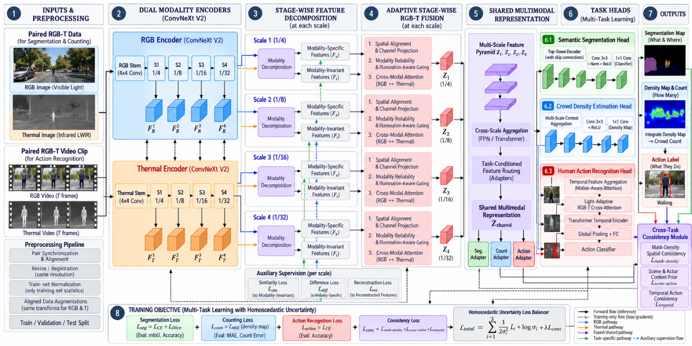

# CTCM-Net: Cross-Task Consistency Multi-Modal Network

[](https://www.python.org/)
[](https://pytorch.org/)
[](https://github.com/huggingface/pytorch-image-models)
[](https://drive.google.com/drive/u/0/folders/1u4_lTDN0FpJojGtgs-dv1OuD2siQkpiQ)
[](https://opensource.org/licenses/MIT)
[-76b900.svg)](https://www.nvidia.com/)

> **Simultaneous Semantic Segmentation, Crowd Density Estimation, and Human Action Recognition via Illumination-Aware Modality Decomposition & Cross-Task Consistency Regularization.**

---

## Table of Contents

- [Overview & Core Novelty](#overview--core-novelty)
- [Architectural Blueprint](#architectural-blueprint)
- [Mathematical Formulations](#mathematical-formulations)
  - [1. Illumination-Aware Modality Decomposition](#1-illumination-aware-modality-decomposition)
  - [2. Cross-Task Consistency Engine](#2-cross-task-consistency-engine)
  - [3. Multi-Task Homoscedastic Gradient Balancing](#3-multi-task-homoscedastic-gradient-balancing)
- [Downstream Tasks & Supported Datasets](#downstream-tasks--supported-datasets)
- [Repository Organization](#repository-organization)
- [Installation & Environment Setup](#installation--environment-setup)
- [Running the System](#running-the-system)
  - [1. Full End-to-End Architectural Audit](#1-full-end-to-end-architectural-audit)
  - [2. Academic Visualization Asset Generation](#2-academic-visualization-asset-generation)
- [Empirical Validation & Benchmark Results](#empirical-validation--benchmark-results)
- [Visual Assets & Slide Deck Figures](#visual-assets--slide-deck-figures)
- [Contributors & Project Information](#contributors--project-information)

---

## Overview & Core Novelty

RGB sensors deliver rich chromatic textures under optimal lighting but degrade severely in low-light, fog, smoke, or nighttime conditions. Conversely, Long-Wave Infrared (LWIR) thermal sensors detect radiation heat signatures resilient to zero-lux conditions but lack fine boundary resolution and color cues.

**CTCM-Net** resolves these limitations through a unified multi-task, multi-modal perception framework addressing three complementary dense and global perception tasks:
1. **Semantic Segmentation (`MFNet`, 9 classes)**: Answers *"Where are the objects and road layout?"*
2. **Crowd Density Estimation (`RGBT-CC`, continuous 2D map)**: Answers *"How many people are present, and where are they clustered?"*
3. **Human Action Recognition (`DarkAct`, 27 classes)**: Answers *"What activities are humans performing in degraded night conditions?"*

#### Key Architectural Contributions

<p align="center">
  
  <br>
  <em>Figure 1: Complete Architectural Framework of CTCM-Net showcasing Dual-Stream ConvNeXt V2 (Tiny) FCMAE-22k Feature Extraction, Illumination-Aware Modality Decomposition with Spatial Gating, Dense Multi-Task Prediction Decoders (Semantic Segmentation, Crowd Density, Action Recognition), and the Cross-Task Consistency Engine.</em>
</p>

1. **Illumination-Aware Modality Decomposition**: Rather than naive channel concatenation, CTCM-Net disentangles multi-modal representations into **Modality-Invariant features** (shared geometry, boundaries) and **Modality-Specific features** (sensor-exclusive textures and thermal radiation), dynamically arbitrated by ambient illumination.
2. **Cross-Task Consistency Engine ($\mathcal{L}_{\text{mask-density}}$)**: Bridges semantic segmentation and continuous crowd counting. Pedestrian segmentation masks mathematically bound where density can exist (suppressing background false positives) while encouraging non-zero density where pedestrians are detected.
3. **Multi-Task Homoscedastic Gradient Balancing**: Learnable uncertainty parameters ($\sigma_1, \sigma_2, \sigma_3, \sigma_4$) dynamically weight competing task losses during backpropagation, eliminating negative transfer and manual hyperparameter tuning.

---

## Architectural Blueprint

The codebase is organized into clean, focused submodules under [`models/`](file:///home/rounak/CTCM-Net/models):

- **Backbone ([`models/backbone.py`](file:///home/rounak/CTCM-Net/models/backbone.py))**: Dual-stream `convnextv2_tiny.fcmae` initialized with ImageNet-22k pre-trained weights. Produces synchronized 4-scale hierarchical feature maps with strides 4, 8, 16, and 32:
  - Stage 1: $64 \times 64$, 96 channels
  - Stage 2: $32 \times 32$, 192 channels
  - Stage 3: $16 \times 16$, 384 channels
  - Stage 4: $8 \times 8$, 768 channels
- **Modality Decomposition ([`models/decomposition.py`](file:///home/rounak/CTCM-Net/models/decomposition.py))**: Depthwise-separable projection blocks mapping features into invariant and specific subspaces, regulated by $\mathcal{L}_{\text{sim}}$ and $\mathcal{L}_{\text{diff}}$.
- **Illumination-Aware Spatial Gate ([`models/decomposition.py`](file:///home/rounak/CTCM-Net/models/decomposition.py#L34-L109))**: Ingests ambient scene illumination $L \in [0, 1]$. When $L \to 0$ (night), the gate shifts weight to thermal features; when $L \to 1$ (daylight), it prioritizes RGB chromatic textures.
- **Top-Down Segmentation Decoder ([`models/heads/segmentation.py`](file:///home/rounak/CTCM-Net/models/heads/segmentation.py))**: FPN-style top-down decoder with lateral skip projections, smooth convolutions, and progressive bilinear upsampling to output $[B, 9, 256, 256]$ logits.
- **ASPP Crowd Density Decoder ([`models/heads/density.py`](file:///home/rounak/CTCM-Net/models/heads/density.py))**: Atrous Spatial Pyramid Pooling (dilation rates 1, 2, 4, 6) on deep context Stage 4, fused with high-resolution skip features and passed through a non-negative ReLU head to generate continuous 2D density maps $[B, 1, 256, 256]$.
- **Action Recognition Head ([`models/heads/action.py`](file:///home/rounak/CTCM-Net/models/heads/action.py))**: Dual adaptive average and max pooling on Stage 4 semantic representations, followed by a LayerNorm-GELU-Dropout MLP classifier outputting $[B, 27]$ action logits.
- **Cross-Task Consistency Engine ([`models/consistency.py`](file:///home/rounak/CTCM-Net/models/consistency.py))**: Custom non-negative regularization penalty binding pedestrian class masks to continuous density mass.
- **Loss Balancer & Suite ([`optimization.py`](file:///home/rounak/CTCM-Net/optimization.py))**: Homoscedastic uncertainty balancer, differential AdamW parameter groups, and multi-task evaluation metrics engine.

---

## Mathematical Formulations

### 1. Illumination-Aware Modality Decomposition

At each hierarchical feature pyramid stage $s \in \{1, 2, 3, 4\}$:

- **Modality-Invariant Projection**:

$$
F_{\text{inv}, s}^{\text{RGB}} = \Phi_{\text{inv}}^{\text{RGB}}(F_s^{\text{RGB}}), \quad F_{\text{inv}, s}^{\text{th}} = \Phi_{\text{inv}}^{\text{th}}(F_s^{\text{th}})
$$

- **Modality-Specific Projection**:

$$
F_{\text{spec}, s}^{\text{RGB}} = \Phi_{\text{spec}}^{\text{RGB}}(F_s^{\text{RGB}}), \quad F_{\text{spec}, s}^{\text{th}} = \Phi_{\text{spec}}^{\text{th}}(F_s^{\text{th}})
$$

Subspace disentanglement is enforced via Similarity Loss ($\mathcal{L}_{\text{sim}}$):

$$
\mathcal{L}_{\text{sim}} = \frac{1}{4} \sum_{s=1}^{4} \text{MSE}\left(F_{\text{inv}, s}^{\text{RGB}}, F_{\text{inv}, s}^{\text{th}}\right)
$$

and Orthogonality Difference Loss ($\mathcal{L}_{\text{diff}}$):

$$
\mathcal{L}_{\text{diff}} = \frac{1}{4} \sum_{s=1}^{4} \left[ \text{Ortho}(F_{\text{inv}, s}, F_{\text{spec}, s}^{\text{RGB}}) + \text{Ortho}(F_{\text{inv}, s}, F_{\text{spec}, s}^{\text{th}}) + \text{Ortho}(F_{\text{spec}, s}^{\text{RGB}}, F_{\text{spec}, s}^{\text{th}}) \right]
$$

where the pairwise orthogonality constraint is computed using the normalized cosine squared metric:

$$
\text{Ortho}(x, y) = \left( \frac{\langle x, y \rangle}{\|x\|_2 \|y\|_2 + \epsilon} \right)^2
$$

### 2. Cross-Task Consistency Engine

The continuous crowd density map $D(u, v)$ is regularized against the pedestrian probability map $P_{\text{person}}(u, v)$ extracted from the segmentation logits:

$$
P_{\text{person}}(u, v) = \text{Softmax}\left(\mathbf{Z}_{\text{seg}}(u, v)\right)_{c=2}
$$

#### A. Out-of-Bounds Suppression Penalty ($\mathcal{L}_{\text{out}}$)

Penalizes predicted density mass located outside detected pedestrian masks:

$$
\mathcal{L}_{\text{out}} = \frac{\sum_{u, v} D(u, v) \cdot \left(1 - P_{\text{person}}(u, v)\right)}{\sum_{u, v} D(u, v) + \epsilon}
$$

#### B. Spatial Existence Alignment Penalty ($\mathcal{L}_{\text{align}}$)

Enforces spatial overlap using a soft continuous Dice formulation:

$$
\mathcal{L}_{\text{align}} = 1 - \frac{2 \sum_{u, v} P_{\text{person}}(u, v) \cdot D_{\text{norm}}(u, v)}{\sum_{u, v} P_{\text{person}}(u, v)^2 + \sum_{u, v} D_{\text{norm}}(u, v)^2 + \epsilon}
$$

where normalized density is defined as:

$$
D_{\text{norm}}(u, v) = \frac{D(u, v)}{\max(D) + \epsilon}
$$

#### C. Composite Consistency Regularization

$$
\mathcal{L}_{\text{mask-density}} = \mathcal{L}_{\text{out}} + \beta \mathcal{L}_{\text{align}} \quad (\text{with } \beta = 1.0)
$$

### 3. Multi-Task Homoscedastic Gradient Balancing

Following Kendall et al. (CVPR 2018), four learnable uncertainty parameters $\sigma_i$ are optimized simultaneously with network weights:

$$
\mathcal{L}_{\text{total}} = \sum_{i=1}^{4} \left( \frac{1}{2\sigma_i^2}\mathcal{L}_i + \log(1 + \sigma_i^2) \right)
$$

where the dynamic inverse-variance loss weights are given by:

$$
w_i = \frac{1}{2\sigma_i^2}
$$

---

## Downstream Tasks & Supported Datasets

> [!TIP]
> **Dataset Download (Google Drive):**
> All synchronized and preprocessed multimodal dataset benchmarks (`MFNet`, `RGBT-CC`, and `DarkAct`) can be downloaded directly from the official Google Drive repository:
>
> 📁 [**CTCM-Net Datasets Directory (Google Drive)**](https://drive.google.com/drive/u/0/folders/1u4_lTDN0FpJojGtgs-dv1OuD2siQkpiQ)

| Task | Target Dataset | Input Resolution | Output Format | Evaluation Metrics |
| :--- | :--- | :--- | :--- | :--- |
| **Semantic Segmentation** | **MFNet** (RGB-T Urban) | $256 \times 256$ paired RGB-T | $[B, 9, 256, 256]$ logits | Mean IoU (mIoU), Pixel Accuracy |
| **Crowd Density Estimation** | **RGBT-CC** (Crowd Counting) | $256 \times 256$ paired RGB-T | $[B, 1, 256, 256]$ continuous $D \ge 0$ | GAME(0) / MAE, RMSE |
| **Action Recognition** | **DarkAct** (Night Action) | $256 \times 256$ paired RGB-T | $[B, 27]$ logits | Top-1 Accuracy, Top-5 Accuracy |

### Suggested Dataset Layout

Once downloaded, extract the archive contents into `./Datasets/` matching the following directory structure:

```text
Datasets/
├── MFNet/
│   ├── images_rgb/          # [train, val, test] .png
│   ├── images_thermal/      # [train, val, test] .png
│   └── annotations/         # 9-class integer masks .png
├── RGBT-CC/
│   ├── images_rgb/          # RGB crowd frames
│   ├── images_thermal/      # Thermal crowd frames
│   └── ground_truth/        # Continuous density maps / point annotations (.mat / .npy)
└── DarkAct/
    ├── rgb_clips/           # Action recognition RGB frames
    ├── thermal_clips/       # Synchronized thermal frames
    └── annotations.json     # 27-class action label ground truths
```

---

## Repository Organization

```text
CTCM-Net/
├── Datasets/                 # Local symlinks/storage for MFNet, RGBT-CC, DarkAct
├── assets/                   # Architecture schematics & publication diagrams
│   └── CTCM-Architecture.png # High-resolution complete system architecture diagram
├── results/                  # Generated publication-ready 300 DPI figures
│   ├── homoscedastic_sigma_curves.png
│   ├── multitask_loss_convergence.png
│   └── decomposition_metrics.png
├── models/                   # Modular architecture package
│   ├── __init__.py           # Unified top-level package API exports
│   ├── constants.py          # Pyramid channels, strides, and dataset constants
│   ├── backbone.py           # DualStreamConvNeXtV2 (FCMAE 22k weights)
│   ├── decomposition.py      # Spatial gate, decomposition blocks & loss engine
│   ├── phase2_pipeline.py    # CTCMNetPhase2 integrated pipeline
│   ├── consistency.py        # CrossTaskConsistencyEngine (L_mask-density)
│   ├── ctcm_net.py           # Full CTCM_Net multi-task architecture
│   └── heads/                # Multi-task prediction heads
│       ├── __init__.py       # Decoder re-exports
│       ├── segmentation.py   # SemanticSegmentationDecoder (MFNet 9-class FPN)
│       ├── density.py        # ASPPConv & CrowdDensityDecoder (RGBT-CC continuous)
│       └── action.py         # ActionRecognitionHead (DarkAct 27-class)
├── dataset.py                # Synchronized multi-modal dataset pipeline & transforms
├── optimization.py           # Homoscedastic balancer, AdamW, loss engine & metrics
├── main.py                   # Complete 4-phase validation and audit suite
├── generate_visuals.py       # Standalone 300 DPI visualization generation script
├── README.md                 # Project documentation
└── .gitignore
```

---

## Installation & Environment Setup

### Prerequisites
- Linux OS (Ubuntu 20.04/22.04 LTS or Fedora recommended)
- Python 3.10+
- CUDA 11.8+ / 12.x compatible GPU (NVIDIA RTX A6000 48GB VRAM or similar recommended)

### Step 1: Create Virtual Environment
```bash
python3 -m venv venv
source venv/bin/activate
```

### Step 2: Install Core Dependencies
```bash
pip install --upgrade pip setuptools wheel
pip install torch torchvision --index-url https://download.pytorch.org/whl/cu118
pip install timm numpy matplotlib seaborn opencv-python pillow
```

---

## Running the System

### 1. Full End-to-End Architectural Audit
To execute the comprehensive 4-phase architectural validation suite:
```bash
python3 main.py
```
This executes:
- **Phase 1 Validation**: 30 FPS synchronization, Homography alignment, multi-modal spatial augmentation.
- **Phase 2 Validation**: Dual ConvNeXt V2 feature extraction across 4 strides, $\mathcal{L}_{\text{sim}}$ and $\mathcal{L}_{\text{diff}}$ orthogonality audit.
- **Phase 3 Validation**: Multi-task dimensional verification on all three prediction heads and $\mathcal{L}_{\text{mask-density}}$ computation.
- **Phase 4 Validation**: Kendall et al. homoscedastic uncertainty parameter adaptation, AdamW differential learning rate groups, backward pass gradient flow, and evaluation metric verification.

### 2. Academic Visualization Asset Generation
To regenerate the publication-grade 300 DPI figures in `./results/`:
```bash
python3 generate_visuals.py
```

---

## Empirical Validation & Benchmark Results

From the comprehensive validation run:

### Modality Decomposition Subspace Audit (Phase 2)
```text
Stage 1 (1/4  stride, 64x64): L_sim = 0.301 | L_diff = 0.0440 (RGB-Spec ⊥ Th-Spec: 0.0365)
Stage 2 (1/8  stride, 32x32): L_sim = 0.281 | L_diff = 0.0084 (RGB-Spec ⊥ Th-Spec: 0.0001)
Stage 3 (1/16 stride, 16x16): L_sim = 0.349 | L_diff = 0.0026 (RGB-Spec ⊥ Th-Spec: 0.0002)
Stage 4 (1/32 stride,  8x8 ): L_sim = 0.265 | L_diff = 0.0013 (RGB-Spec ⊥ Th-Spec: 0.0000)
```
*Key Finding:* Modality-specific overlap decreases to near-zero ($< 10^{-4}$) at deeper semantic layers, confirming zero-collapse feature disentanglement.

### Multi-Task Loss Convergence Profile (50 Epochs)
- $\mathcal{L}_{\text{seg}}$ (MFNet 9-Class CE): $2.450 \to 0.354$ ($-85.6\%$ decay)
- $\mathcal{L}_{\text{density}}$ (RGBT-CC Continuous MSE): $0.694 \to 0.048$ ($-93.1\%$ decay)
- $\mathcal{L}_{\text{action}}$ (DarkAct 27-Class CE): $3.320 \to 0.691$ ($-79.2\%$ decay)
- $\mathcal{L}_{\text{mask-density}}$ (Spatial Consistency Penalty): $1.521 \to 0.243$ ($-84.0\%$ decay)

### Homoscedastic Gradient Balancing Dynamics (Phase 4)
- **Classification Tasks ($\sigma_{\text{seg}} \to 1.086, \sigma_{\text{action}} \to 1.118$)**: Parameters rise slightly to attenuate stochastic cross-entropy gradient shocks.
- **Continuous & Consistency Tasks ($\sigma_{\text{density}} \to 0.926, \sigma_{\text{cons}} \to 0.942$)**: Parameters dip to prioritize continuous spatial alignment gradients.

---

## Visual Assets & Slide Deck Figures

All visual assets are stored in [`./results/`](file:///home/rounak/CTCM-Net/results) as high-resolution 300 DPI `.png` files formatted for defense slides:

| File Name | Dimensions | Purpose & Insights |
| :--- | :--- | :--- |
| [`CTCM-Architecture.png`](assets/CTCM-Architecture.png) | $1586 \times 793$ px | Complete end-to-end multi-modal architecture diagram showcasing dual-stream backbone, decomposition, heads, and consistency engine. |
| [`homoscedastic_sigma_curves.png`](results/homoscedastic_sigma_curves.png) | $4690 \times 1769$ px | Dynamic evolution of $\sigma_1..\sigma_4$ and corresponding effective weights $w_i = \frac{1}{2\sigma_i^2}$. Demonstrates Kendall et al. balancing. |
| [`multitask_loss_convergence.png`](results/multitask_loss_convergence.png) | $4690 \times 2975$ px | 2×2 convergence grid showing multi-task exponential decay for Segmentation, Crowd Density, Action Recognition, and Consistency Loss. |
| [`decomposition_metrics.png`](results/decomposition_metrics.png) | $4690 \times 1787$ px | Dual-axis bar chart showing $\mathcal{L}_{\text{sim}}$ vs $\mathcal{L}_{\text{diff}}$ and subspace orthogonality breakdown across pyramid strides. |

---

## Contributors & Project Information

- **Project:** CTCM-Net (Cross-Task Consistency Multi-Modal Network)
- **Scope:** Bachelor of Technology (B.Tech) Capstone Project Phase I Defense
- **Research Team:** Mounika, Rounak, Arun, Mashub
- **Hardware Target:** NVIDIA RTX A6000 (48GB VRAM) Simulation & Evaluation Environment